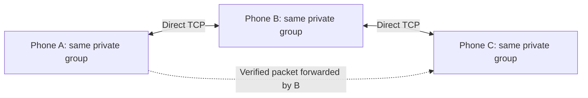

# Phase 1 review and connection/data guide — 2026-11-02

This guide describes the revised source code. It supersedes the earlier 54-byte protocol, global auto-mesh key, plaintext session recovery, and unconditional background-execution claims. Scope is Phase 1; Phase 2 stranger relaying, routing tables, and expanded hop bytes remain unimplemented.

## Changes applied

| Area | Defect | Revision |
| --- | --- | --- |
| Cryptography | The nonce was derived from session ID and an initials-derived slot/counter. A restart or slot collision could repeat a nonce under the same key. | CryptoKit generates a fresh 12-byte nonce for every seal. Protocol v3 transmits it, increasing frames from 54 to 66 bytes. |
| Group formation | The default group used a secret hardcoded in the app; random-byte generation ignored failure. | Every new group gets its own CryptoKit-generated 256-bit key. Sharing an invite is required to join that group. |
| Persistence | UserDefaults stored the complete session, including its raw group key. | SwiftData stores only an authenticated encrypted snapshot; its wrapping key lives in Keychain. Explicit saves, 12-hour recovery expiry, and key-first deletion on leave are implemented. Old UserDefaults sessions are discarded. |
| Concurrency | Network value types inherited MainActor isolation; the project used Swift 5 mode. | Swift 6 language mode, explicit nonisolated packet/value types, main-actor UI models, and actor-owned capture/transport operations. The iOS 26 deployment target is unchanged. |
| Connection identity | Initials were also Bonjour connection IDs, inbound links stayed anonymous, and prefix filtering could exclude valid peers. | Per-start random UUID service IDs, exact self filtering, a 36-byte UUID introduction, and deterministic duplicate-socket selection. The introduction does not authenticate group membership. |
| Lifecycle | Old callbacks/retries could affect a replacement session; an old socket could remove a newer connection. | Session generation checks, socket identity checks, 32-connection admission bounds, and a 10-second identity timeout. |
| Membership | Bonjour metadata/TCP readiness could create apparent friends. | Only authenticated decrypted payloads populate the group roster. Connection IDs are separate from member initials. |
| Forwarding | Invalid SOS packets could still be forwarded; duplicate keys used colliding short slots/sequences; packets were echoed to ingress. | Authentication before forwarding, normalized full-frame fingerprints, bounded 256-entry/5-minute caches, no self-origin forwarding, and ingress exclusion. |
| Retries | A failure on one socket could retry a broadcast to all healthy sockets; retries bypassed queue capacity. | Retries target the failed socket and respect the urgent queue bound. |
| Location | Arrival time replaced the GPS measurement time; heading bytes were treated as degrees. | Preserve measurement time, reject older fixes, refresh map freshness with a timeline, decode heading as byte × 360/255, and use true-north headings for GPS bearings. |
| Emergency replay | SOS transmission age was indistinguishable from a possibly old GPS fix. | Encrypted SOS `sentAt` uses reserved bytes. SOS older than five minutes or too far in the future is rejected. Seen SOS IDs survive secure session recovery and suppress repeat alarms. |
| Teardown | Local GPS/heading could remain cached after leaving; publications captured a permanently active session. | Clear local coordinates/heading, stop publishers before asynchronous companion shutdown, and use current-session providers with cancellation checks. |
| SwiftUI | Finder opened the first friend, close GPS distance implied UWB availability, strobe/hold tasks survived disappearance, and a manual toggle binding ignored the assigned value. | Preserve selected friend, show GPS-only guidance, hide the arrow without a valid heading, respect Reduce Motion for the beacon, cancel disappearing/background tasks, use a direct model binding, and separate hold gestures from category/reset controls. |
| Camera | A rejected scan/declined agreement could permanently disable rescanning; capture control crossed actor boundaries. | Validate invites before accepting scans, drive scanning from agreement state, and serialize blocking capture start/stop in an actor. |
| Meetings | Missing GPS fabricated a festival location; repeated proposals could erase attendance. | Require an actual location or map selection, and merge repeated proposals for the same meeting ID. |
| Diagnostics/consent | UI displayed key bytes as a fingerprint and promised unsupported stranger relay, BLE transport, and continuous locked-phone delivery. | Show a truncated SHA-256 fingerprint and explain the actual Phase 1 capabilities and iOS delivery limits. |

## How phones connect

1. A host creates a private group. The group key is 32 random bytes; the group ID is a nonzero 16-bit value.
2. The invite is a `teekum://join#key=...&sid=...&name=...` URL, shown as a QR code or shared as text. It carries the group key, group ID, and group name. Treat it as a secret: anyone holding it can join/decrypt that group. It is not sent as part of routine radio discovery.
3. After agreement, each phone advertises/browses `_teekum._tcp` using `NWListener` and `NWBrowser`, with `includePeerToPeer = true`. The app requests Apple's peer-to-peer networking; it does not implement its own Bluetooth radio link or select a physical Wi-Fi channel.
4. Bonjour discovery exposes a random service UUID plus TXT fields `sid` and `version`. It also exposes ordinary service/address/port metadata. No group key, GPS coordinates, or initials are included in the revised advertisement.
5. Matching session/version peers connect over TCP. The lexicographically smaller UUID normally initiates; a delayed fallback handles missed connections. Each direction first sends its own 36-byte UTF-8 UUID. If two sockets exist, both sides choose the same canonical direction.
6. TCP is a stream, so a framer buffers partial reads and splits coalesced reads into complete 66-byte packets. The application decrypts and verifies the packet before displaying a friend, sounding SOS, or forwarding it.
7. A regular ping broadcasts to every ready direct socket. If a group member receives a verified packet from another group member, it can rebroadcast to its other direct sockets, incrementing only the hop count. This is bounded same-group flooding, not an implemented AODV route-selection protocol.

A and C do not need a direct socket if B bridges them. All three must have this group's key in the current implementation. B can decrypt the group packet because it is a group member. Stranger zero-knowledge relaying is a Phase 2 feature.

There is no cloud server or internet upload in this transport path. MapKit and the system's ordinary services are separate from the group packet protocol; this is not a guarantee that every OS/network activity is offline.

## Exact application frame after revision

The app's fixed application frame is **66 bytes**. TCP/IP, Wi-Fi, Bonjour, and retransmission overhead are additional.

| Wire offsets (zero-based) | Bytes | Contents | Visibility |
| --- | ---: | --- | --- |
| 0 | 1 | Protocol version 3 (high nibble), message type (low nibble) | Cleartext, authenticated |
| 1 | 1 | Hop limit/high nibble and hop count/low nibble | Cleartext; hop limit authenticated, count mutable |
| 2–3 | 2 | Group/session ID, big-endian | Cleartext, authenticated |
| 4–7 | 4 | Sequence: 8-bit slot plus 24-bit counter | Cleartext, authenticated |
| 8–19 | 12 | Fresh random ChaChaPoly nonce | Public; tampering prevents successful decryption |
| 20–49 | 30 | Encrypted application payload | Only group-key holders can decrypt |
| 50–65 | 16 | Poly1305 authentication tag | Public verification data |

The nonce is not a password or group key. The sequence/slot is no longer relied upon for nonce uniqueness. Initials remain short display/member IDs, so group members must choose distinct initials; this revision does not add individual public-key identities.

The original 54-byte v2 format is rejected, and discovery requires the new version. All participating phones must use the revised build. Protocol v3 here is the Phase 1 security revision; the earlier docs' proposed v3 expanded-hop sketch was never implemented and must be revisited for Phase 2. Hop fields still allow 1–15, with ordinary default 8 and SOS/meeting default 15.

## What data is inside each encrypted payload

### Normal location/status ping — type 1

| Payload offsets | Bytes | Data |
| --- | ---: | --- |
| 0–3, 4–7 | 4 + 4 | Latitude and longitude as signed big-endian integers, degrees × 1,000,000 |
| 8–11 | 4 | Original GPS measurement time, Unix seconds |
| 12 | 1 | Horizontal accuracy, meters capped at 255 |
| 13 | 1 | Status enum: available, on my way, lost, waiting, drinks, restroom, etc. |
| 14–17 | 4 | Optional target reference; zero means none |
| 18–19 | 2 | Sender's 1–3 initials encoded in Base 27 |
| 20 | 1 | Battery percentage |
| 21 | 1 | Heading, quantized 0–255 representing 0–360 degrees |
| 22–29 | 8 | Reserved zeros |

Default requested cadence is four seconds while moving, twenty seconds while stationary, sixty seconds in Survival Mode. These are scheduling targets, not delivery guarantees. Ordinary status changes piggyback on the next ping. Live Sharing OFF stops ordinary publishing and pauses GPS/heading collection; SOS can still use the cached fix without waiting.

### SOS — type 2

Location, GPS measurement time, accuracy, fixed SOS status, random SOS event ID, sender initials, emergency category (general/medical/lost/security), battery, and a separate transmission time. `sentAt` occupies payload bytes 22–25, leaving bytes 26–29 reserved. A missing GPS fix is encoded with timestamp zero, zero coordinates, and accuracy 255; it must not be treated as a genuine measured location.

SOS begins after the three-second hold, bypasses the normal cadence, and uses the urgent queue with bounded retries. A recipient possessing the group key validates it before alarming and generates an encrypted delivery ACK.

### Meeting update — type 3

Meeting coordinates, intended meetup time, action (propose/accept/decline/cancel), attendance, meeting-point ID, sender initials, optional landmark ID, and up to six UTF-8 bytes of custom label. This fixed-width label is not a full arbitrary-length meeting name.

### Delivery ACK — type 6

Original sequence number, original sender initials, receipt timestamp, ACK status (friend delivery versus relay receipt), original event ID, and responding member initials. The reserved RSSI field is currently zero/unknown: this Network-framework adapter does not measure actual per-peer dBm. A socket write or nearby relay alone does not prove friend delivery.

Route-request/response payload codecs (types 4/5) exist but are not wired into an operating routing-table/discovery feature.

## Persistence and platform boundaries

- SwiftData contains one encrypted recovery snapshot, not location history. The snapshot includes session details and already-seen incoming SOS IDs. The wrapping key uses Keychain `AfterFirstUnlockThisDeviceOnly`; CloudKit is disabled. Models and contexts stay on the main actor, and saves are explicit.
- Leaving deletes the Keychain wrapping key before deleting the SwiftData record. Thus old SQLite/WAL copies contain ciphertext whose key has been removed. Previous plaintext UserDefaults copies cannot be retroactively erased from old backups; new sessions use fresh keys.
- Recovery expires after twelve hours; active sessions also check expiry once per minute and when scene state changes. Live Sharing and relay work are subject to iOS scheduling.
- A Live Activity or location indicator does not guarantee always-on sockets, locked-phone reception, or reliable SOS delivery. Keep the app visible during active coordination and verify behavior on real phones.
- Precision Nearby Interaction/UWB is not implemented. Finder uses GPS/compass estimates with their associated accuracy and age.
- No stranger relay, 2-packets/second communal policy, timed relay approvals, routing tables, or expanded 8-bit hop fields are claimed in this Phase 1 revision.
- Duplicate packet caches are bounded and in memory. SOS event evidence persists across recovery; this is not a complete durable replay ledger for every meeting/location packet. Meeting conflict resolution under simultaneous independent proposals remains a Phase 2 design item.

## Verification

Both final simulator and physical-iPhone builds succeeded under Swift 6. The iPhone 17 / iOS 26.5 simulator run passed **92 checks in 8 suites**: codec 13, transport 13, crypto 13, location 12, UI/model state 12, SOS 11, Live Activity 5, and new Phase 1 regressions 13. `git diff --check` passed. Build signing was disabled for compilation checks.

The final build logs contain only Xcode’s AppIntents metadata-skipped notice, with no source warnings/errors. See the matching development-log entry for commands and evidence paths.

Physical multi-phone AWDL, radio range, camera scanning, background delivery, and Lock Screen behavior require device validation; simulator suites and device compilation do not establish those capabilities. Visual interaction, rotation, and accessibility behavior were revised in source but have not been exhaustively exercised on physical hardware.
