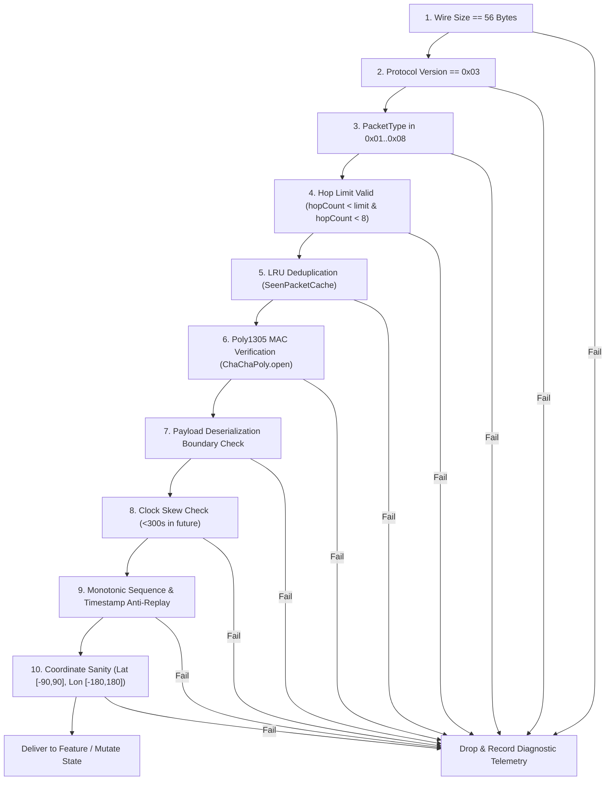
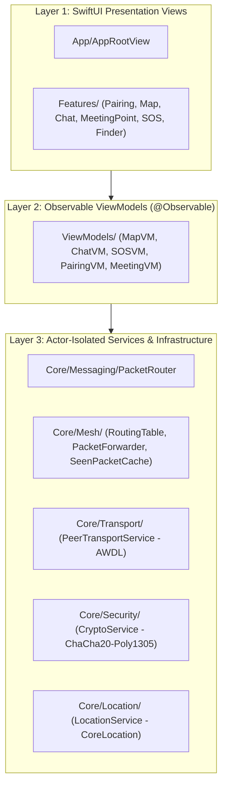

# TeeKum 101: The Serverless Festival Mesh Architecture
## The Definitive Engineering Handbook & Technology Deep Dive

> **Project:** TeeKum (Fantasix Team)  
> **Target Audience:** Systems Engineers, iOS Core Developers, Protocol Designers, and Curious Junior Developers  
> **Platform:** iOS 17.0+ (Swift 5.9 / Swift 6 Ready, Pure Native Frameworks, Zero Third-Party Dependencies)  
> **Architecture:** Feature-Driven MVVM + Swift Observation (`@Observable`) + Actor Concurrency  
> **Networking:** 100% Serverless Peer-to-Peer & Multi-Hop Mesh (Network.framework AWDL / Bonjour)  
> **Encryption:** RFC 8439 ChaCha20-Poly1305 Authenticated Encryption with Associated Data (AEAD)  
> **Wire Standard:** Fixed 56-Byte Binary Datagram (Protocol v3)  

---

## Table of Contents
1. [Preface: The Festival Paradox](#preface-the-festival-paradox)
2. [Chapter 1: The 4 Non-Negotiable Invariants](#chapter-1-the-4-non-negotiable-invariants)
3. [Chapter 2: The Physics & Mathematics of the 56-Byte Wire Protocol](#chapter-2-the-physics--mathematics-of-the-56-byte-wire-protocol)
   - [2.1 Why Exactly 56 Bytes?](#21-why-exactly-56-bytes)
   - [2.2 Memory Map of the Wire Frame](#22-memory-map-of-the-wire-frame)
   - [2.3 Coordinate Quantization Math (~11 cm Precision)](#23-coordinate-quantization-math-11-cm-precision)
   - [2.4 The 2-Byte Base-27 Initials Codec](#24-the-2-byte-base-27-initials-codec)
   - [2.5 The 24-Bit Session ID (`UInt24`)](#25-the-24-bit-session-id-uint24)
   - [2.6 The Nonce Partitioning & Two-Time Pad Collision Prevention](#26-the-nonce-partitioning--two-time-pad-collision-prevention)
   - [2.7 The Mutable Hop Masking Trick (AAD Invariance)](#27-the-mutable-hop-masking-trick-aad-invariance)
4. [Chapter 3: The 30-Byte Payloads (The 8 Radio Message Types)](#chapter-3-the-30-byte-payloads-the-8-radio-message-types)
   - [3.1 Type 0x01: Location Ping (Option B Telemetry)](#31-type-0x01-location-ping-option-b-telemetry)
   - [3.2 Type 0x02: Emergency SOS](#32-type-0x02-emergency-sos)
   - [3.3 Type 0x03: Meeting Point Update](#33-type-0x03-meeting-point-update)
   - [3.4 Type 0x04 & 0x05: AODV Route Discovery (RREQ / RREP)](#34-type-0x04--0x05-aodv-route-discovery-rreq--rrep)
   - [3.5 Type 0x06: Cryptographic Delivery ACK](#35-type-0x06-cryptographic-delivery-ack)
   - [3.6 Type 0x07: Festival Group Mesh Chat](#36-type-0x07-festival-group-mesh-chat)
   - [3.7 Type 0x08: Nearby Interaction Token Exchange](#37-type-0x08-nearby-interaction-token-exchange)
   - [3.8 The Codec Architecture: `PacketReader` and `PacketWriter`](#38-the-codec-architecture-packetreader-and-packetwriter)
5. [Chapter 4: The Physical Layer: Apple Wireless Direct Link (AWDL) & Network.framework](#chapter-4-the-physical-layer-apple-wireless-direct-link-awdl--networkframework)
   - [4.1 What is AWDL? How AirDrop Communicates Off-Grid](#41-what-is-awdl-how-airdrop-communicates-off-grid)
   - [4.2 Configuring `NWListener` and `NWConnection` for P2P](#42-configuring-nwlistener-and-nwconnection-for-p2p)
   - [4.3 Bonjour Peer Discovery (`_teekum._tcp`)](#43-bonjour-peer-discovery-_teekum_tcp)
   - [4.4 The TCP Stream Framing Problem](#44-the-tcp-stream-framing-problem)
   - [4.5 `StreamMessageFramer`: Delimiting & Corruption Resynchronization](#45-streammessageframer-delimiting--corruption-resynchronization)
6. [Chapter 5: The Ad-Hoc Multi-Hop Mesh Network](#chapter-5-the-ad-hoc-multi-hop-mesh-network)
   - [5.1 The Range Barrier and Multi-Hop Theory](#51-the-range-barrier-and-multi-hop-theory)
   - [5.2 Bounded Flooding vs. AODV On-Demand Routing](#52-bounded-flooding-vs-aodv-on-demand-routing)
   - [5.3 The 7-Byte Composite Deduplication Key & 1,024-Entry LRU Cache](#53-the-7-byte-composite-deduplication-key--1024-entry-lru-cache)
   - [5.4 Dual-Lane Token Bucket Rate Limiting](#54-dual-lane-token-bucket-rate-limiting)
   - [5.5 The Communal Relay Policy & 20% Hard Cutoff](#55-the-communal-relay-policy--20-hard-cutoff)
   - [5.6 Circular Routing Loop Elimination & The 8-Hop Ceiling](#56-circular-routing-loop-elimination--the-8-hop-ceiling)
7. [Chapter 6: Cryptography, Key Exchange & Security Boundaries](#chapter-6-cryptography-key-exchange--security-boundaries)
   - [6.1 100% Serverless Key Exchange via URL Fragments](#61-100-serverless-key-exchange-via-url-fragments)
   - [6.2 QR Barcode Pipeline via CoreImage and AVFoundation](#62-qr-barcode-pipeline-via-coreimage-and-avfoundation)
   - [6.3 Hardware-Backed Keychain Key Storage](#63-hardware-backed-keychain-key-storage)
   - [6.4 The 10-Step Inbound Ingestion Pipeline](#64-the-10-step-inbound-ingestion-pipeline)
   - [6.5 Zero-Knowledge Relay Boundary Guarantees](#65-zero-knowledge-relay-boundary-guarantees)
8. [Chapter 7: Subsystems & Sensor Engines](#chapter-7-subsystems--sensor-engines)
   - [7.1 The Dynamic GNSS & CoreMotion Location Engine](#71-the-dynamic-gnss--coremotion-location-engine)
   - [7.2 Emergency SOS, Priority Preemption & Inactivity Guard ("Man Down")](#72-emergency-sos-priority-preemption--inactivity-guard-man-down)
   - [7.3 Festival Group Mesh Chat & The Byte Limiter](#73-festival-group-mesh-chat--the-byte-limiter)
   - [7.4 Tactical Polar Radar & The Decommissioning of UWB](#74-tactical-polar-radar--the-decommissioning-of-uwb)
   - [7.5 Single Active Meeting Point & The Setter Lock Rule](#75-single-active-meeting-point--the-setter-lock-rule)
   - [7.6 ActivityKit Live Activities & Dynamic Island Control](#76-activitykit-live-activities--dynamic-island-control)
9. [Chapter 8: Code Architecture & Anatomy of a Feature-Driven App](#chapter-8-code-architecture--anatomy-of-a-feature-driven-app)
   - [8.1 The 3-Tier Layering Model](#81-the-3-tier-layering-model)
   - [8.2 Swift Observation (`@Observable`) vs Combine Boilerplate](#82-swift-observation-observable-vs-combine-boilerplate)
   - [8.3 Actor Isolation & Thread Safety](#83-actor-isolation--thread-safety)
   - [8.4 The Central Inbound Demux: `PacketRouter`](#84-the-central-inbound-demux-packetrouter)
10. [Chapter 9: Engineering Trivia, Design Trade-Offs & War Stories](#chapter-9-engineering-trivia-design-trade-offs--war-stories)
    - [9.1 Why SQLite Was Abandoned](#91-why-sqlite-was-abandoned)
    - [9.2 Why Apple Ultra-Wideband (UWB) Failed at Festivals](#92-why-apple-ultra-wideband-uwb-failed-at-festivals)
    - [9.3 Why the URL `#` Fragment Is an Anonymous Privacy Superpower](#93-why-the-url--fragment-is-an-anonymous-privacy-superpower)
    - [9.4 The 20-Byte Text Limit & Byte Budgeting](#94-the-20-byte-text-limit--byte-budgeting)
    - [9.5 Dancing in Place: Fooling the Motion Coprocessor](#95-dancing-in-place-fooling-the-motion-coprocessor)
11. [Epilogue: Building for Harsh Environments](#epilogue-building-for-harsh-environments)

---

## Preface: The Festival Paradox

Every summer, tens of thousands of music lovers gather in remote valleys, speedways, and parks for music festivals. They bring state-of-the-art smartphones packing multicore neural engines, multi-band 5G transceivers, and satellite radios.

And yet, within thirty minutes of gates opening, **every single smartphone becomes practically useless for communication**.

This is **The Festival Paradox**.

```
[Festival Ground: 80,000 Phones]
       │       │       │
       ▼       ▼       ▼
   ┌───────────────────────┐
   │ Cell Tower (Base Stn) │ ──> RF Collision & Random Access Channel (RACH) Overload
   └───────────────────────┘
               │
               ▼
     [PACKET DROP HELL]
 (No WhatsApp, No iMessage, No Google Maps, No Cell Signal)
```

### Why Cellular Networks Fail at Festivals
1. **Radio Frequency (RF) Contention:** Cellular base stations partition wireless spectrum into finite frequency/time slots. When 25,000 people inside a single stage footprint attempt to transmit simultaneously, the Random Access Channel (RACH) collides constantly. Phones cannot even complete an initial handshake with the tower.
2. **Backhaul Congestion:** Even if temporary cells-on-wheels (COWs) are deployed, the physical fiber or microwave backhaul linking the local antennas to the wider internet becomes completely saturated.
3. **DNS and Keep-Alive Overhead:** Modern chat apps (WhatsApp, Telegram, Apple iMessage) maintain persistent TLS sockets and ping remote cloud servers dozens of times per minute. In an environment with 90% packet loss, these reconnection handshakes enter catastrophic exponential backoff spirals, draining batteries in 3 hours while sending 0 bytes of real user messages.

### The TeeKum Counter-Philosophy
TeeKum was created by the **Fantasix Team** around a radically simple premise:
> **If the cloud cannot reach the festival, the festival must become its own computer.**

TeeKum does not talk to Amazon Web Services. It has no Google Firebase database, no user accounts, no login screens, no verification SMS codes, and no backend API. 

Instead, every iPhone running TeeKum acts as an autonomous node in an off-grid, peer-to-peer radio mesh. Phones talk directly to neighboring phones using peer-to-peer Wi-Fi and Bluetooth. When a friend is 300 meters away across a crowded festival stage, your message hops across the phones of friendly strangers who don't even know what your message says—relaying encrypted packets until your friend receives them in single-digit milliseconds.

---

## Chapter 1: The 4 Non-Negotiable Invariants

In system engineering, an **invariant** is a property that must remain true across every execution path, every edge case, and every commit. TeeKum is governed by four core architectural invariants:

```
┌────────────────────────────────────────────────────────────────────────┐
│                      THE 4 TEEKUM INVARIANTS                           │
├─────────────────────────────┬──────────────────────────────────────────┤
│ 1. 56-Byte Wire Datagram   │ Fixed-size packets; zero traffic analysis│
├─────────────────────────────┼──────────────────────────────────────────┤
│ 2. Zero-Knowledge Relaying │ Strangers forward blind; keys stay private│
├─────────────────────────────┼──────────────────────────────────────────┤
│ 3. Honest Delivery UX       │ Never fake delivery confirmations        │
├─────────────────────────────┼──────────────────────────────────────────┤
│ 4. Festival Survival Mode   │ Hard radio cutoff at 20% device battery  │
└─────────────────────────────┴──────────────────────────────────────────┘
```

### 1. The Fixed 56-Byte Wire Invariant
Every datagram transmitted or received over the physical radio is **exactly 56 bytes**. 
There are no 55-byte packets. There are no 57-byte packets. 
- Location pings? 56 bytes.
- Emergency SOS alerts? 56 bytes.
- Rendezvous updates? 56 bytes.
- 20-character chat messages? 56 bytes.
- Routing probes? 56 bytes.

**Why?**
In traditional networked software, variable-length payloads require length headers, memory reallocations, and framing delimiters. Worse, variable payload sizes leak metadata: an adversary sniffing wireless packets can easily differentiate a tiny status ping from a long text message. By fixing all packets to 56 bytes, every transmission looks identical over the air. Memory buffers are pre-allocated and zero dynamic heap allocation is required during packet serialization.

### 2. Zero-Knowledge Blind Relaying
A festival mesh only works if strangers relay each other's packets. However, nobody wants strangers reading their locations or private messages.

TeeKum guarantees **Zero-Knowledge Relaying**:
- Every packet has a 10-byte cleartext outer envelope and a 30-byte ChaCha20-encrypted payload sealed with a 16-byte Poly1305 MAC tag.
- When your phone receives a packet belonging to an outside festival group (a different `sessionId`), your phone **does not and cannot decrypt it**.
- Your phone inspects only the 10-byte cleartext envelope (checking hop count, duplicate cache, and rate limit tokens) and broadcasts it forward blind.
- The contents of the packet remain cryptographically sealed until they reach a phone that possesses the group's 256-bit symmetric key.

### 3. Honest Delivery UX
In consumer messaging apps, UI trickery is rampant: apps show fake checkmarks or optimistic bubble transitions before the server has even acknowledged the packet.

In a festival crowd, **fake delivery confirmations can be fatal**. If a user triggers an emergency SOS or tries to locate a lost friend in a medical emergency, claiming an alert was delivered when it only left the local antenna can lead to tragedy.

TeeKum enforces **5-State Honest Delivery Semantics**:
1. `.acceptedLocally`: The packet entered the local outbox queue.
2. `.forwardedToNextHop`: The local antenna transmitted the packet to at least one physical peer link.
3. `.relayedByMeshHop`: A neighboring mesh node confirmed receipt and is relaying it forward across the crowd.
4. `.deliveredToFriend`: **Cryptographic proof** was received. The destination friend’s device decrypted the packet and transmitted a signed `ACKPayload` back across the mesh.
5. `.deliveryTimedOut`: Retry budgets exhausted without receiving proof. The UI displays: *"Relayed by Mesh (Friend Unconfirmed)"*.

### 4. Festival Survival Mode (Hard 20% Battery Cutoff)
A dead phone is an emergency hazard at night. 

To prevent TeeKum from ever being responsible for stranding a user with a dead battery, the app monitors device battery levels via `UIDevice.current.batteryLevel`. 
The moment battery drops to **20%** or the user enables iOS **Low Power Mode**:
- All stranger packet relaying is terminated immediately.
- Background location polling and radio sockets are suspended.
- The GPS receiver throttles down to on-demand only.
- The phone reserves its remaining power strictly for the user to view the offline meeting map or trigger a 3-second Emergency SOS.

---

## Chapter 2: The Physics & Mathematics of the 56-Byte Wire Protocol

Let us dissect the wire datagram with bit-level precision.

```
0                   1                   2                   3
0 1 2 3 4 5 6 7 8 9 0 1 2 3 4 5 6 7 8 9 0 1 2 3 4 5 6 7 8 9 0 1
+-+-+-+-+-+-+-+-+-+-+-+-+-+-+-+-+-+-+-+-+-+-+-+-+-+-+-+-+-+-+-+-+
|Ver|  Type     |   Hop Limit   |   Hop Count   |   Session     |
+-+-+-+-+-+-+-+-+-+-+-+-+-+-+-+-+-+-+-+-+-+-+-+-+-+-+-+-+-+-+-+-+
|   ID (cont.)  |              Sequence Number                  |
+-+-+-+-+-+-+-+-+-+-+-+-+-+-+-+-+-+-+-+-+-+-+-+-+-+-+-+-+-+-+-+-+
|                                                               |
+                    Encrypted Payload (30 Bytes)               +
|                  (ChaCha20 RFC 8439 Ciphertext)               |
+                                                               +
|                                                               |
+-+-+-+-+-+-+-+-+-+-+-+-+-+-+-+-+-+-+-+-+-+-+-+-+-+-+-+-+-+-+-+-+
|                                                               |
+                   Poly1305 MAC Tag (16 Bytes)                 +
|               (Authenticates Envelope AAD + Cipher)           |
+-+-+-+-+-+-+-+-+-+-+-+-+-+-+-+-+-+-+-+-+-+-+-+-+-+-+-+-+-+-+-+-+
```

### 2.1 Why Exactly 56 Bytes?
Why not 64 bytes? Why not 32 bytes?
The 56-byte figure is the product of an exact budget optimization between:
1. **Airtime on 2.4 GHz & 5 GHz Bands:** A 56-byte frame requires less than 0.2 milliseconds of physical radio transmission time on an 802.11ac physical layer. This ultra-short burst minimizes RF channel occupancy in high-density environments.
2. **Apple Wireless Direct Link (AWDL) Frame Overhead:** 56 bytes fits cleanly inside a single unfragmented 802.11 action frame without triggering layer-2 fragmentation.
3. **ChaCha20-Poly1305 Alignment:** RFC 8439 produces a fixed 16-byte Poly1305 MAC tag. Allocating 30 bytes for the inner payload + 10 bytes for cleartext routing creates an even, cache-line-friendly structure ($10 + 30 + 16 = 56$).

### 2.2 Memory Map of the Wire Frame

| Byte Offset | Wire Type | Field Name | Description |
| :---: | :---: | :--- | :--- |
| **0** | `UInt8` | `versionAndType` | High 4 bits: Version (`0x03` = Protocol v3). Low 4 bits: Type (`0x01`..`0x08`). |
| **1** | `UInt8` | `hopLimit` | Maximum allowable hops ($1 \dots 15$, default 8, SOS 15). Immutable; sealed in AAD. |
| **2** | `UInt8` | `hopCount` | Hops traversed ($0 \dots \text{hopLimit}$). Incremented (+1) by relays. **Masked to `0x00` in AAD**. |
| **3..5** | `UInt24` | `sessionId` | 24-bit big-endian group session identifier ($16,777,216$ namespaces). |
| **6..9** | `UInt32` | `sequenceNumber` | Partitioned: High 8 bits = `memberSlot`, Low 24 bits = monotonic counter. |
| **10..39**| `30 Bytes` | `encryptedPayload` | 30 bytes of ChaCha20 ciphertext containing private coordinate/chat telemetry. |
| **40..55**| `16 Bytes` | `authTag` | 128-bit Poly1305 authentication tag binding ciphertext and envelope AAD. |

### 2.3 Coordinate Quantization Math (~11 cm Precision)
In Apple's `CoreLocation` framework, geographical latitude and longitude are represented as 64-bit IEEE 754 floating-point numbers (`Double`, known as `CLLocationDegrees`).

If we transmitted raw 64-bit doubles:
$$\text{Latitude (8 Bytes)} + \text{Longitude (8 Bytes)} = 16\text{ Bytes}$$
That would consume more than **half** of our entire 30-byte encrypted payload!

#### The Quantization Transformation
TeeKum quantizes coordinates into signed 32-bit big-endian integers (`Int32`):
$$\text{latitudeRaw} = \operatorname{round}(\text{latitude} \times 1{,}000{,}000)$$
$$\text{longitudeRaw} = \operatorname{round}(\text{longitude} \times 1{,}000{,}000)$$

To unpack them upon receipt:
$$\text{latitude} = \frac{\text{latitudeRaw}}{1{,}000{,}000.0}$$
$$\text{longitude} = \frac{\text{longitudeRaw}}{1{,}000{,}000.0}$$

#### Deriving the Physical Precision
The circumference of the Earth at the equator is approximately $40{,}075{,}017\text{ meters}$.
There are $360^\circ$ of longitude around the globe:
$$\text{Meters per degree of longitude at equator} = \frac{40{,}075{,}017}{360} \approx 111{,}319.49\text{ m}$$

With our scaling factor of $1{,}000{,}000$ ($10^6$ units per degree):
$$\text{Resolution} = \frac{111{,}319.49\text{ m}}{1{,}000{,}000} \approx 0.1113\text{ meters} \approx \mathbf{11.13\text{ centimeters}}$$

At non-equatorial latitudes (e.g. London at $51.5^\circ$ or Tokyo at $35.6^\circ$), meridians converge by $\cos(\text{latitude})$, making the east-west resolution even finer (~7 cm).

#### Boundary Range Limits
The maximum possible coordinate values fit safely inside signed 32-bit integers (`Int32.min` to `Int32.max` = $-2{,}147{,}483{,}648$ to $+2{,}147{,}483{,}647$):
- North Pole: $+90.000000^\circ \rightarrow +90{,}000{,}000$ (Safe: $< 2.14 \times 10^9$)
- South Pole: $-90.000000^\circ \rightarrow -90{,}000{,}000$ (Safe: $> -2.14 \times 10^9$)
- Antimeridian: $+180.000000^\circ \rightarrow +180{,}000{,}000$ (Safe: $< 2.14 \times 10^9$)
- West Antimeridian: $-180.000000^\circ \rightarrow -180{,}000{,}000$ (Safe: $> -2.14 \times 10^9$)

By quantizing coordinates into `Int32`, we preserve **sub-decimeter accuracy** worldwide while freeing up 8 full bytes of payload budget!

### 2.4 The 2-Byte Base-27 Initials Codec
How do you identify which member sent a packet?
If you store a member's name as a string (e.g. `"Nicho"`), you consume 5 to 16 bytes of ASCII/UTF-8. Furthermore, P2P mesh networks typically require a noisy "connection handshake" where nodes exchange user profiles and display names.

TeeKum solves this with the **2-Byte Base-27 Initials Codec**.

#### The Radix Space
Festival attendees enter 1 to 3 uppercase initials ($A \dots Z$, e.g. `"D"`, `"AB"`, `"NIC"`).
We define an alphabet where:
- Empty / Null slot: $0$
- Character `A`: $1$
- Character `B`: $2$
- $\dots$
- Character `Z`: $26$

Base radix = $27$.

#### Permutation Calculus
- 1-letter initials ($A \dots Z$): $26$ possibilities
- 2-letter initials ($AA \dots ZZ$): $26 \times 26 = 676$ possibilities
- 3-letter initials ($AAA \dots ZZZ$): $26 \times 26 \times 26 = 17{,}576$ possibilities

$$\text{Total Combinations} = 26 + 676 + 17{,}576 = \mathbf{18{,}278}$$

A standard unsigned 16-bit integer (`UInt16`) stores values from $0$ to $65{,}535$ ($2^{16} - 1$).
Because $18{,}278 \le 65{,}535$, **every possible 1, 2, or 3-letter initial in the English alphabet fits into exactly 2 bytes (`UInt16`)!**

#### The Encoding Formula
Given 3 character slots $c_0, c_1, c_2$:
$$\text{val}(c) = \begin{cases} 0 & \text{if slot is empty} \\ \text{ASCII}(c) - 64 & \text{if } c \in ['A' \dots 'Z'] \end{cases}$$
$$\text{Encoded UInt16} = (a \times 27^2) + (b \times 27^1) + (c \times 27^0) = (\mathbf{a \times 729}) + (\mathbf{b \times 27}) + \mathbf{c}$$

#### Swift Implementation
```swift
public enum InitialsCodec {
    public static func encode(_ initials: String) -> UInt16 {
        let clean = initials.uppercased().filter { $0 >= "A" && $0 <= "Z" }
        guard !clean.isEmpty else { return 0 }
        let chars = Array(clean.prefix(3))
        
        let a = UInt32(chars[0].asciiValue! - 64)
        let b = chars.count > 1 ? UInt32(chars[1].asciiValue! - 64) : 0
        let c = chars.count > 2 ? UInt32(chars[2].asciiValue! - 64) : 0
        
        let val = (a * 729) + (b * 27) + c
        return UInt16(min(val, 65535))
    }

    public static func decode(_ code: UInt16) -> String {
        guard code > 0 else { return "??" }
        var rem = UInt32(code)
        let c = rem % 27; rem /= 27
        let b = rem % 27; rem /= 27
        let a = rem % 27
        
        var result = ""
        if a >= 1 && a <= 26, let scalar = UnicodeScalar(UInt8(a + 64)) { result.append(Character(scalar)) }
        if b >= 1 && b <= 26, let scalar = UnicodeScalar(UInt8(b + 64)) { result.append(Character(scalar)) }
        if c >= 1 && c <= 26, let scalar = UnicodeScalar(UInt8(c + 64)) { result.append(Character(scalar)) }
        return result.isEmpty ? "??" : result
    }
}
```

**The Architectural Win:**
Every packet is **self-describing**. When a friend's packet pops out of the radio, the receiving device instantly decodes the 2-byte initials and renders the avatar badge on the Map and Radar without any handshake or name resolution table!

### 2.5 The 24-Bit Session ID (`UInt24`)
Groups are assigned a 24-bit session ID (`0x000001` to `0xFFFFFF`), providing **$16{,}777{,}215$ unique session namespaces**.

When a group is created:
1. The host device generates a cryptographic seed from current timestamp, GPS coordinates, and CSPRNG salt.
2. The seed is hashed via SHA-256.
3. The lowest 24 bits are taken, guaranteeing non-zero (`0x000000` is reserved for system discovery).

In the outer envelope, `sessionId` occupies exactly 3 bytes (Bytes 3..5). This allows intermediate mesh nodes to discard packets from uninteresting sessions or filter stranger packets without performing expensive cryptographic operations.

### 2.6 The Nonce Partitioning & Two-Time Pad Collision Prevention
Under RFC 8439, ChaCha20 generates a stream of pseudorandom keystream blocks by encrypting an incrementing counter with a 256-bit key and a 96-bit (12-byte) initialization vector (Nonce).

> [!CAUTION]
> **The Two-Time Pad Catastrophe:** If the same `(Key, Nonce)` pair is ever reused to encrypt two different payloads, an attacker can simply XOR the two ciphertexts together:
> $$C_1 \oplus C_2 = (P_1 \oplus K) \oplus (P_2 \oplus K) = P_1 \oplus P_2$$
> The key cancels out completely, exposing the plaintexts!

In a group where 6 friends share a single symmetric key, how do we guarantee that Device A and Device B will **never** generate the same Nonce, even if they reboot or start sending at the exact same millisecond?

#### The 12-Byte Nonce Structure
```text
Byte 0..2:  sessionId (UInt24 big-endian, 3 bytes)
Byte 3..6:  sequenceNumber (UInt32 big-endian, 4 bytes)
Byte 7:      versionAndType (UInt8, Byte 0 of envelope)
Byte 8..11: Protocol Domain Tag: [0x54, 0x4B, 0x4D, 0x33] (ASCII "TKM3", 4 bytes)
```

#### Sequence Number Partitioning
To guarantee zero nonce collisions across multiple group members, the 32-bit `sequenceNumber` is partitioned:
$$\text{sequenceNumber} = (\text{memberSlot} \ll 24) \mid (\text{counter} \ \& \ \mathtt{0x00FFFFFF})$$

- **High 8 bits (bits 24..31):** `memberSlot` ($0 \dots 255$). Assigned uniquely upon joining the session.
- **Low 24 bits (bits 0..23):** Monotonic per-device packet counter ($1 \dots 16{,}777{,}215$).

Because each friend occupies a distinct, non-overlapping `memberSlot`, their sequence numbers operate in completely disjoint mathematical spaces. Device 1 generates sequence numbers in `0x01000000...0x01FFFFFF`, while Device 2 generates sequence numbers in `0x02000000...0x02FFFFFF`. 

**Nonce collisions are mathematically impossible.**

### 2.7 The Mutable Hop Masking Trick (AAD Invariance)
In ChaCha20-Poly1305, Associated Authenticated Data (AAD) is data that is authenticated (tamper-proof) but transmitted in cleartext.

In a multi-hop mesh:
- Node A transmits a packet with `hopCount = 0`.
- Node B (a stranger relay) receives it, increments `hopCount = 1`, and forwards it.
- Node C receives it, increments `hopCount = 2`, and forwards it to Friend D.

**The Cryptographic Paradox:**
If the entire 10-byte cleartext envelope is authenticated by Poly1305, when Relay B modifies `hopCount` from `0` to `1`, the Poly1305 authentication tag will fail on Friend D's device! But if we leave the envelope unauthenticated, an adversary could tamper with `sessionId` or `hopLimit` to create infinite routing loops.

#### The TeeKum Solution: Zero-Masking AAD
When computing the Poly1305 tag during sealing and opening, Byte 2 (`hopCount`) is **normalized to `0x00`**:

$$\text{AAD} = \mathtt{byte0} \parallel \mathtt{hopLimit} [1\text{B}] \parallel \mathbf{0x00} [1\text{B}] \parallel \mathtt{sessionId} [3\text{B}] \parallel \mathtt{sequenceNumber} [4\text{B}]$$

```text
Cleartext Wire Envelope:  [ 0x31 | 0x08 | 0x03 | 0x12 0x34 0x56 | 0x01 0x00 0x00 0x42 ]
                                         ▲
                                 hopCount is 3 on wire

Masked Envelope for AAD:  [ 0x31 | 0x08 | 0x00 | 0x12 0x34 0x56 | 0x01 0x00 0x00 0x42 ]
                                         ▲
                                 Masked to 0x00 for Poly1305
```

**What this achieves:**
1. `version`, `type`, `hopLimit`, `sessionId`, and `sequenceNumber` are 100% tamper-proof. If an adversary attempts to modify `hopLimit` to induce broadcast storms, the Poly1305 tag fails instantly and the packet is dropped.
2. Relays can freely increment `hopCount` across multiple hops without breaking the recipient's ability to verify the cryptographic signature!

---

## Chapter 3: The 30-Byte Payloads (The 8 Radio Message Types)

Every single one of the 8 packet types carries an encrypted payload of exactly **30 bytes**.

```
+--------------------------------------------------------------------------+
|                  30-BYTE ENCRYPTED PAYLOAD ARCHITECTURE                  |
+--------------------------------------------------------------------------+
| Type 0x01: LOCATION_PING     -> 18B Telemetry + 12B Reserved Altimetry   |
| Type 0x02: SOS               -> 22B Emergency Event + 8B Reserved        |
| Type 0x03: MEETING_UPDATE    -> 24B Rendezvous + 6B Custom Label         |
| Type 0x04: ROUTE_REQ         -> 9B AODV Query + 21B Padding              |
| Type 0x05: ROUTE_RESP        -> 9B AODV Response + 21B Padding           |
| Type 0x06: ACK               -> 18B Delivery Evidence + 12B Reserved     |
| Type 0x07: CHAT_MESSAGE      -> 7B Envelope + 20B UTF-8 Text + 3B Res.   |
| Type 0x08: UWB_TOKEN_EXCH.   -> 5B Header + 25B Discovery Token Payload  |
+--------------------------------------------------------------------------+
```

### 3.1 Type 0x01: Location Ping (Option B Telemetry)
In Phase 3, TeeKum adopted **Option B Telemetry Packing**, stripping out legacy status codes and packing geographic telemetry contiguously into Bytes 0..17, leaving a consolidated 12-byte contiguous block for vertical venue altimetry:

```text
Bytes 0..3:   latitudeRaw (Int32 big-endian, ~11cm resolution)
Bytes 4..7:   longitudeRaw (Int32 big-endian, ~11cm resolution)
Bytes 8..11:  timestamp (UInt32 big-endian Unix epoch seconds)
Byte 12:      accuracy (UInt8, horizontal uncertainty radius in meters)
Bytes 13..14: senderInitials (UInt16, 2-byte Base-27 encoded initials)
Byte 15:      batteryLevel (UInt8, 0..100 percentage)
Byte 16:      heading (UInt8, compass degrees * 255 / 360)
Byte 17:      memberColor (UInt8, 1 of 8 neon avatar theme colors)
Bytes 18..29: reserved (12 bytes reserved for Phase 3 floorLevel & barometry)
```

### 3.2 Type 0x02: Emergency SOS
High-priority distress alert broadcast when a user holds the emergency button for 3 continuous seconds or the motion coprocessor detects an unconscious "Man Down":

```text
Bytes 0..3:   latitudeRaw (Int32 big-endian)
Bytes 4..7:   longitudeRaw (Int32 big-endian)
Bytes 8..11:  timestamp (UInt32 big-endian, hardware measurement time)
Byte 12:      accuracy (UInt8)
Byte 13:      statusCode (UInt8, fixed 0x01 SOS)
Bytes 14..17: sosEventId (UInt32 big-endian, unique 32-bit distress event ID)
Bytes 18..19: senderInitials (UInt16 Base-27)
Byte 20:      emergencyType (UInt8: 0x00 General, 0x01 Medical, 0x02 Lost, 0x03 Inactivity)
Byte 21:      batteryLevel (UInt8)
Bytes 22..29: reserved (8 bytes padding)
```

### 3.3 Type 0x03: Meeting Point Update
Coordinates and rendezvous countdown for the group's single active meeting landmark:

```text
Bytes 0..3:   meetingLat (Int32 big-endian)
Bytes 4..7:   meetingLon (Int32 big-endian)
Bytes 8..11:  meetupTime (UInt32 big-endian epoch seconds)
Byte 12:      action (UInt8: 0x01 Propose, 0x02 Accept, 0x03 Decline, 0x04 Cancel)
Byte 13:      attendanceStatus (UInt8: 0x01 Going, 0x02 Cannot, 0x09 Arrived)
Bytes 14..17: meetingPointId (UInt32 big-endian unique rendezvous ID)
Bytes 18..19: senderInitials (UInt16 Base-27)
Bytes 20..23: landmarkId (UInt32 big-endian predefined landmark preset)
Bytes 24..29: customLabel (6 bytes UTF-8 string or zero-padding)
```

### 3.4 Type 0x04 & 0x05: AODV Route Discovery (RREQ / RREP)
When a friend has not been seen for $>45$ seconds, TeeKum switches from passive waiting to proactive route discovery:

```text
Bytes 0..1:   originatorInitials (UInt16 Base-27)
Bytes 2..3:   targetInitials (UInt16 Base-27 destination)
Bytes 4..7:   discoveryNonce (UInt32 big-endian, suppresses duplicate RREQ floods)
Byte 8:       routeCost (UInt8 metric / cumulative hop count)
Bytes 9..29:  reserved (21 bytes zero-padding)
```

### 3.5 Type 0x06: Cryptographic Delivery ACK
Provides non-repudiable proof of packet delivery across the mesh:

```text
Bytes 0..3:   ackedSeqNumber (UInt32 big-endian sequence number confirmed)
Bytes 4..5:   ackedSenderInitials (UInt16 Base-27 of the message author)
Bytes 6..9:   ackTimestamp (UInt32 big-endian receipt epoch seconds)
Byte 10:      ackStatus (UInt8: 0x01 Delivered to Friend, 0x02 Relayed by Mesh Hop)
Byte 11:      receivedRssi (Int8, arrival signal strength in signed dBm)
Bytes 12..15: originalEventId (UInt32 big-endian matches sosEventId or meetingPointId)
Bytes 16..17: responderInitials (UInt16 Base-27 of confirming node)
Bytes 18..29: reserved (12 bytes padding)
```

### 3.6 Type 0x07: Festival Group Mesh Chat
Introduced in Phase 3 to eliminate rigid status codes:

```text
Bytes 0..1:   senderInitials (UInt16 Base-27)
Bytes 2..5:   timestamp (UInt32 big-endian epoch seconds)
Byte 6:       textLength (UInt8, length in bytes: 0..20)
Bytes 7..26:  textBytes (20 bytes standard UTF-8 encoded text)
Bytes 27..29: reserved (3 bytes padding)
```

### 3.7 Type 0x08: Nearby Interaction Token Exchange
Transmits Apple Ultra-Wideband (UWB) spatial discovery tokens between devices when initiating close-range micro-navigation:

```text
Bytes 0..1:   senderInitials (UInt16 Base-27)
Bytes 2..3:   targetInitials (UInt16 Base-27)
Byte 4:       tokenLength (UInt8, byte length of serialized NIDiscoveryToken)
Bytes 5..29:  tokenData (25 bytes raw Apple UWB token payload)
```

### 3.8 The Codec Architecture: `PacketReader` and `PacketWriter`
In C or low-level systems, pointer manipulation can easily lead to buffer overruns. In TeeKum, all binary serialization and deserialization is governed by **bounds-checked safe streams** in [`PacketCodec.swift`](file:///Users/nicho/Developer/TeeKum%20Prototype/TeeKum%20Prototype/Core/Messaging/PacketCodec.swift):

```swift
public final class PacketWriter {
    public private(set) var data: Data

    public init(capacity: Int = 30) {
        self.data = Data(capacity: capacity)
    }

    public func writeUInt8(_ value: UInt8) {
        data.append(value)
    }

    public func writeUInt16BigEndian(_ value: UInt16) {
        var bigEndian = value.bigEndian
        withUnsafeBytes(of: &bigEndian) { data.append(contentsOf: $0) }
    }

    public func writeInt32BigEndian(_ value: Int32) {
        var bigEndian = value.bigEndian
        withUnsafeBytes(of: &bigEndian) { data.append(contentsOf: $0) }
    }

    public func writeBytes(_ bytes: Data) {
        data.append(bytes)
    }
}
```

The matching `PacketReader` checks bounds before every read operation; if a packet has fewer remaining bytes than requested, it throws a safe `PacketCodecError.bufferUnderflow` rather than triggering a crash or undefined memory read.

---

## Chapter 4: The Physical Layer: Apple Wireless Direct Link (AWDL) & Network.framework

How does TeeKum communicate between two iPhones in the middle of a desert when there are no Wi-Fi access points or cellular towers?

### 4.1 What is AWDL? How AirDrop Communicates Off-Grid
Most developers know Apple AirDrop. You can send a 2 GB video to a friend sitting next to you on an airplane with Wi-Fi and Bluetooth toggled on, without being connected to an internet router.

Under the hood, AirDrop is powered by **Apple Wireless Direct Link (AWDL)**.
AWDL is Apple’s proprietary peer-to-peer Wi-Fi protocol. Unlike standard Wi-Fi (which requires an infrastructure Access Point acting as a central master), AWDL allows iOS devices to:
1. Synchronize radio clock channels using Bluetooth Low Energy (BLE) advertisements.
2. Periodically hop their Wi-Fi chips onto a shared private channel (channel 6 or channel 149) for a few milliseconds (the *Availability Window*).
3. Transmit high-speed 802.11 peer-to-peer frames directly antenna-to-antenna.
4. Hop back to whatever Wi-Fi channel they were on before, without interrupting other background tasks.

### 4.2 Configuring `NWListener` and `NWConnection` for P2P
Starting in iOS 12, Apple exposed AWDL access through `Network.framework` via the `includePeerToPeer` parameter on `NWParameters`:

```swift
let tcpParams = NWParameters.tcp
tcpParams.includePeerToPeer = true
tcpParams.prohibitedInterfaceTypes = [.cellular] // Strictly peer-to-peer radio

let listener = try NWListener(using: tcpParams)
listener.service = NWListener.Service(
    name: localPeerID.uuidString, 
    type: "_teekum._tcp", 
    domain: "local.", 
    txtRecord: txtRecordData
)
```

By specifying `includePeerToPeer = true` and advertising a custom Bonjour service (`_teekum._tcp`), the iOS kernel automatically coordinates AWDL channels and establishes peer-to-peer TCP/IP links between devices within 30 to 50 meters.

### 4.3 Bonjour Peer Discovery (`_teekum._tcp`)
Every device advertises a Bonjour TXT record:
- `relay: 1` if Communal Relay is enabled.
- `relay: 0` if Communal Relay is disabled or device is in Survival Mode.

An `NWBrowser` instance constantly listens for neighboring nodes advertising `_teekum._tcp`:
- **Group Peers:** If the incoming connection identifies as a group member, a bidirectional connection is retained in the active connection pool.
- **Stranger Peers:** If the neighbor is an outside festival attendee, a connection is retained **only if both nodes have `relay == 1`**. If either node enters Survival Mode (<20% battery), the link is torn down cleanly.

### 4.4 The TCP Stream Framing Problem
Here is an essential networking lesson for every junior developer:

> [!WARNING]
> **TCP is a Byte Stream, NOT a Packet Protocol!**  
> If you call `connection.send(data: 56_bytes)` on Device A, Device B's operating system might receive:
> - A single 56-byte chunk, OR
> - A 20-byte chunk followed by a 36-byte chunk (fragmentation), OR
> - Two 56-byte packets glued together into one 112-byte chunk (conglutination)!

If your code simply assumes `content.count == 56`, it will drop packets or crash when network fragmentation occurs.

### 4.5 `StreamMessageFramer`: Delimiting & Corruption Resynchronization
To solve this, TeeKum routes all inbound network data through [`StreamMessageFramer.swift`](file:///Users/nicho/Developer/TeeKum%20Prototype/TeeKum%20Prototype/Core/Transport/StreamMessageFramer.swift).

```
Incoming Stream Chunks:
[ 24 Bytes ] ───┐
                ├──> Accumulate in Ring Buffer ──> Emit [ 56 Bytes Frame 1 ]
[ 48 Bytes ] ───┘                                  Accumulate remaining [ 16 Bytes ]
                                                           │
[ 40 Bytes ] ──────────────────────────────────────────────┴──> Emit [ 56 Bytes Frame 2 ]
```

#### How the Framer Works:
1. **Accumulation:** Raw bytes are appended to an internal buffer (`Data`).
2. **Frame Emission:** While `buffer.count >= 56`:
   - Inspect the first byte: high nibble must equal `0x03` (Protocol Version 3) and low nibble must be a valid `PacketType` (`0x01`..`0x08`).
   - If valid: Slice exactly 56 bytes, emit as a verified `InboundPacket`, and remove those 56 bytes from the buffer head.
3. **Corruption Resynchronization:** If Byte 0 is not a valid version and type header (e.g. noise or stream corruption), the framer scans forward byte-by-byte until it finds a valid `0x3X` marker, discarding corrupted bytes and resynchronizing the stream.
4. **Buffer Overflow Guard:** The internal buffer is capped at $64\text{ KB}$. If malicious noise fills the buffer without a valid frame marker, the entire buffer is purged to prevent memory exhaustion.

---

## Chapter 5: The Ad-Hoc Multi-Hop Mesh Network

Direct peer-to-peer radio (AWDL) has an effective physical range of **30 to 50 meters** in an open field, and often drops to **15 to 25 meters** in dense crowds packed with human bodies (which are 70% water and absorb 2.4 GHz radio waves).

However, festival venues are often **500 to 1,500 meters wide**.

```
[ Alice (Stage A) ] 
       │ 30m
       ▼
 [ Stranger Node 1 ] 
       │ 35m
       ▼
 [ Stranger Node 2 ] 
       │ 40m
       ▼
  [ Bob (Food Court) ]
```

To bridge this distance, TeeKum turns festival phones into a **multi-hop cooperative mesh**.

### 5.1 The Range Barrier and Multi-Hop Theory
In a multi-hop mesh, every node acts as both an endpoint and a router. When Alice sends a packet to Bob, Intermediate Node 1 forwards it to Node 2, which forwards it to Bob.

### 5.2 Bounded Flooding vs. AODV On-Demand Routing
TeeKum implements a **Hybrid Routing Strategy**:

| Traffic Kind | Routing Algorithm | Max Hops | Behavior |
| :--- | :--- | :---: | :--- |
| **Emergency SOS** | Immediate Bounded Flooding | 15 | Radiates in all directions through all available neighbors with maximum priority. |
| **Location Telemetry** | Bounded Flooding | 8 | Disseminates periodically across direct neighbors and relays. |
| **Delivery ACKs** | Reverse-Path Unicast | 8 | Follows the cached reverse path over which the original message arrived. |
| **Stale Peer Recovery** | AODV (`ROUTE_REQ` / `ROUTE_RESP`) | 8 | On-demand route discovery triggered only when a friend goes unseen for $>45$s. |

### 5.3 The 7-Byte Composite Deduplication Key & 1,024-Entry LRU Cache
In flooding meshes, the greatest danger is a **Broadcast Storm**: Node A sends to Node B; Node B sends to Node C; Node C sends back to Node A; and packets loop indefinitely, crashing the radio network.

TeeKum eliminates broadcast loops using [`SeenPacketCache.swift`](file:///Users/nicho/Developer/TeeKum%20Prototype/TeeKum%20Prototype/Core/Mesh/SeenPacketCache.swift).

#### The 7-Byte Key
A packet is uniquely identified by:
$$\text{PacketKey} = (\text{sessionId: 3 Bytes}) \parallel (\text{sequenceNumber: 4 Bytes})$$

> [!IMPORTANT]
> **Why `hopCount` must NOT be in the Deduplication Key:**  
> When a packet is forwarded across 3 hops, `hopCount` changes ($0 \rightarrow 1 \rightarrow 2$). If the deduplication key included `hopCount`, a node seeing the same packet arrive from two different paths with different hop counts would fail to recognize it as a duplicate! By keying strictly on `(sessionId, sequenceNumber)`, the packet is recognized as duplicate regardless of which hop it arrived on.

#### The 1,024-Entry Sliding Window
- Implemented as an actor-isolated Doubly Linked List + Dictionary (LRU Cache).
- Capacity: 1,024 entries.
- Retention Window: 300 seconds (5 minutes).
- Any packet whose `PacketKey` exists in the cache is dropped immediately with `.dropDuplicate`.

### 5.4 Dual-Lane Token Bucket Rate Limiting
To prevent battery drain and radio congestion, [`ForwardingRateLimiter.swift`](file:///Users/nicho/Developer/TeeKum%20Prototype/TeeKum%20Prototype/Core/Mesh/ForwardingRateLimiter.swift) enforces a **Dual-Lane Token Bucket**:

```
                       [ Incoming Packets to Relay ]
                                     │
                    Is Packet Type == SOS (0x02)?
                                ╱         ╲
                             YES           NO
                             ╱               ╲
     [ SOS Token Bucket Lane ]               [ Ordinary Token Bucket Lane ]
     • Fill Rate: 4.0 tokens/sec             • Fill Rate: 2.0 tokens/sec
     • Max Burst Capacity: 8 tokens          • Max Burst Capacity: 4 tokens
     • Preempts ordinary queue               • Throttled during heavy traffic
```

If an outside node attempts to spam packets through your phone, the token bucket exhausts its tokens and excess packets are dropped with `.rateLimited`. Emergency SOS traffic uses an independent reserve lane that can burst up to 4 packets/second.

### 5.5 The Communal Relay Policy & 20% Hard Cutoff
Participation in the mesh is strictly governed by [`RelayPolicyManager.swift`](file:///Users/nicho/Developer/TeeKum%20Prototype/TeeKum%20Prototype/Core/Mesh/RelayPolicyManager.swift):
1. **Always Active:** Phone participates in communal relaying as long as battery is $\ge 20\%$.
2. **Timed 30 Min:** Relays for 30 minutes (e.g. while sitting with friends), then automatically pauses relaying.
3. **Disabled:** Phone does not forward packets for strangers (acts as an end-node only).

When device battery drops below 20%, the system enters **Festival Survival Mode**: relaying is killed instantly, no matter what setting was selected.

### 5.6 Circular Routing Loop Elimination & The 8-Hop Ceiling
Every packet enforces two hard termination checks:
1. `envelope.hopCount >= envelope.hopLimit`: Drop packet.
2. `envelope.hopCount >= 8`: Drop packet (Protocol ceiling for normal traffic).

This guarantees that no packet can ever survive more than 8 hops, mathematically bounding total mesh bandwidth consumption.

---

## Chapter 6: Cryptography, Key Exchange & Security Boundaries

Security in TeeKum is designed around the assumption that **the radio spectrum is hostile**. Anybody with a Wi-Fi sniffer or SDR (Software Defined Radio) can record every byte transmitted over the venue.

### 6.1 100% Serverless Key Exchange via URL Fragments
How do you create a private encrypted group when you have no internet access and no cloud server?

When Alice creates a group named *"Festival Squad"*:
1. Her phone generates a random 256-bit symmetric key (`CryptoKit.SymmetricKey`, 32 cryptographically secure random bytes).
2. Her phone derives a 24-bit `sessionId` (`UInt24`).
3. Her phone encodes this into a custom URL scheme:
   `teekum://join#key=Base64KeyString&sid=A1B2C3&name=Festival+Squad`

```
teekum://join#key=YWJjZGVmZ2hpamtsbW5vcHFyc3R1dnd4eXoxMjM0NTY=&sid=A1B2C3&name=Squad
            │
            └─> THE HASH FRAGMENT (#)
```

#### Trivia: Why the URL Hash Fragment (`#`) Is an Anonymous Privacy Superpower
Notice that the credentials follow the **hash fragment (`#`)** rather than query parameters (`?key=...`).

In RFC 3986, **the fragment of a URI is handled purely on the client side**. 
If a user taps this link inside an SMS or web browser, the HTTP client **never transmits the fragment across the network to the server**:
- An HTTP `GET` request contains only `teekum://join`.
- The web server hosting the landing page **never sees the symmetric key** in its access logs!
- The key is parsed strictly in-memory by iOS on the recipient device.

### 6.2 QR Barcode Pipeline via CoreImage and AVFoundation
If friends are already together at the festival without any cellular connection, Alice displays a QR barcode:
1. `QRCodeView.swift` passes the URL string to CoreImage's native `CIQRCodeGenerator` filter with high error correction (`H`).
2. Bob taps *"Join Group"* and opens `QRScannerView.swift`, which runs an `AVCaptureSession` searching for `AVMetadataObject.ObjectType.qr`.
3. In under 100 milliseconds, Bob's camera parses the QR barcode, extracts the symmetric key and session ID into memory, and joins the mesh.

### 6.3 Hardware-Backed Keychain Key Storage
Once acquired, the group's 256-bit key is written to the iOS Keychain via `Security.framework`:
- Accessibility Attribute: `kSecAttrAccessibleAfterFirstUnlockThisDeviceOnly`.
- The key cannot be extracted via cloud backups or synced across devices.
- The moment the user taps *"Leave Group"* or the session expires (1-hour inactivity), `SecItemDelete` purges the key material from disk and Secure Enclave.

### 6.4 The 10-Step Inbound Ingestion Pipeline
Every 56-byte datagram received over the radio passes through an unyielding 10-step gauntlet in [`PacketRouter.swift`](file:///Users/nicho/Developer/TeeKum%20Prototype/TeeKum%20Prototype/Core/Messaging/PacketRouter.swift):



If a packet fails **any** step:
- It is immediately discarded.
- Zero application state is mutated.
- The failure reason is logged into `MeshDiagnostics` counters for real-time triage.

### 6.5 Zero-Knowledge Relay Boundary Guarantees
Notice where Step 6 sits:
If a packet arrives whose `sessionId` does not match our active group:
- The router bypasses Step 6 (it does not attempt decryption because it lacks the key).
- It routes the packet directly to `handleStrangerRelayPacket`.
- Stranger payloads are forwarded as completely opaque ciphertext.

---

## Chapter 7: Subsystems & Sensor Engines

### 7.1 The Dynamic GNSS & CoreMotion Location Engine
GPS receivers consume substantial power. If an app runs the iPhone GPS at full accuracy continuously, an iPhone 15 battery will drain in approximately 4 to 5 hours.

TeeKum implements an **Adaptive Cadence & Dynamic Accuracy Engine** in [`LocationService.swift`](file:///Users/nicho/Developer/TeeKum%20Prototype/TeeKum%20Prototype/Core/Location/LocationService.swift):

```
                                  [ User Motion State ]
                                            │
                       ┌────────────────────┴────────────────────┐
                       ▼                                         ▼
              [ Device Stationary ]                     [ Device Walking ]
        • GPS: kCLLocationAccuracyHundredMeters    • GPS: kCLLocationAccuracyBest
        • Distance Filter: 15 meters              • Distance Filter: None (Continuous)
        • Broadcast Cadence: Every 15–30s         • Broadcast Cadence: Every 3–5s
```

#### Motion Coprocessor Sleep
Using `CMMotionActivityManager`, TeeKum queries the iPhone's low-power M-series motion coprocessor:
- When the user stands still at a stage, the GPS receiver is throttled down to 100-meter accuracy and broadcasts only once every 20 seconds. This saves **~70% of GPS battery consumption**.
- When the user starts walking, the coprocessor wakes up the GPS receiver within 2–3 seconds, transitioning to high-cadence 3–5s pings.

#### Dual-Frequency L1/L5 Navigation Boost
When the user opens the **Tactical Radar View**, `LocationService.applyDynamicAccuracy()` automatically engages `kCLLocationAccuracyBestForNavigation`:
- Activates the iPhone's dual-frequency **L1/L5 GNSS radio**, filtering out multipath radio bounces from festival stages and metal scaffolding.
- Heading filter is set to $0^\circ$ for butter-smooth compass rotation.
- When the user closes the radar back to the Map, accuracy returns to standard battery-optimized levels.

### 7.2 Emergency SOS, Priority Preemption & Inactivity Guard ("Man Down")
Distress alerts are the most critical function of TeeKum.

#### 1. The 3-Second Hold State Machine
To prevent accidental triggers in crowded mosh pits or while jumping to music:
- Tapping the SOS button does nothing.
- The user must maintain continuous thumb contact for **3.0 continuous seconds**.
- An animated neon progress ring fills clockwise with haptic ticking patterns (`UIImpactFeedbackGenerator`).
- If the user releases before 3.0 seconds, the timer cancels and resets to zero.

#### 2. Urgent Queue Preemption
Standard location pings sit in a coalescing outbox. When an SOS packet is triggered:
- It bypasses all normal queues and is inserted at the head of `PriorityOutboxQueue`.
- It broadcasts immediately, preempting pending pings.
- The device triggers 3 rapid-fire burst transmissions spaced by 1.5 seconds.
- An audible siren alert (`AudioServicesPlaySystemSound(1304)`) and heavy alert haptics (`UINotificationFeedbackGenerator`) play on all recipient friend devices.

#### 3. Inactivity Guard ("Man Down" Watchdog)
If a festival attendee collapses, faints from dehydration, or suffers an overdose, they may be unable to press the SOS button.

In Phase 3, TeeKum introduced [`InactivityGuardService.swift`](file:///Users/nicho/Developer/TeeKum%20Prototype/TeeKum%20Prototype/Features/SOS/Services/InactivityGuardService.swift):
- An opt-in motion watchdog monitors accelerometer data.
- If the device remains completely motionless for **180 seconds** (3 minutes) in an active festival session:
  1. The app starts a **30-second Pre-Alarm Warning**:
     - The screen pulses with amber visual rings.
     - Gentle haptic pulses tap the user's wrist/pocket.
     - A large **[I'M OK]** button is presented.
  2. If the user touches the screen, moves the phone, or taps "I'M OK", the alarm cancels immediately.
  3. If 30 seconds elapse without movement or interaction, the system automatically constructs and broadcasts an **Emergency SOS** (`emergencyType = .inactivity`), alerting all group members that their friend is down and unconscious.

### 7.3 Festival Group Mesh Chat & The Byte Limiter
In Phase 3, TeeKum replaced rigid 1-byte status codes with **Festival Group Mesh Chat** (`PacketType.chatMessage = 0x07`):

```
┌────────────────────────────────────────────────────────┐
│ [Beer line]  [At Main Stage]  [Restroom]  [On my way]  │ <- Preset Chips
├────────────────────────────────────────────────────────┤
│ Meet at sound booth                               18/20│ <- Dynamic Byte Meter
└────────────────────────────────────────────────────────┘
```

#### The 20-Byte Boundary & Byte Limiter
Why 20 bytes?
Because $2\text{B initials} + 4\text{B timestamp} + 1\text{B length} + \mathbf{20\text{B text}} + 3\text{B reserved} = \mathbf{30\text{ Bytes}}$ (our exact encrypted payload budget!).

However, in UTF-8:
- ASCII characters (`A-Z`, `0-9`, punctuation) take 1 byte each.
- Accented characters (`é`, `ñ`) take 2 bytes each.
- Emojis (🍺, 📍, 🆘) take **4 bytes each**.

If a user pastes a string with 20 emojis, that would require 80 bytes!
[`ByteMeterView.swift`](file:///Users/nicho/Developer/TeeKum%20Prototype/TeeKum%20Prototype/Features/Chat/Views/ByteMeterView.swift) intercepts text input on every keystroke and paste:
1. It measures the exact UTF-8 byte count: `text.utf8.count`.
2. If pasted text exceeds 20 bytes, it truncates the string along valid Unicode scalar character boundaries $\le 20$ bytes.
3. It renders a real-time byte gauge:
   - Green: $0 \dots 14$ bytes.
   - Orange: $15 \dots 18$ bytes.
   - Red: $19 \dots 20$ bytes.

Messages are transmitted over a dedicated FIFO outbox lane (up to 2 retries, 3s cooldown) with per-friend cryptographic delivery tracking (*"Delivered to 3/4 friends"*).

### 7.4 Tactical Polar Radar & The Decommissioning of UWB
How do you guide a user toward their friend in a pitch-black, 80,000-person crowd?

```
                     Ahead (0°)
                     ┌───▲───┐
                  15m│   │   │
                     │  (•)  │ <- Friend Blip
                  30m│       │
      9 o'clock ─────┼───+───┼───── 3 o'clock
                  60m│       │
                     │       │
                     └───▼───┘
                    Behind (180°)
```

#### Why Apple Ultra-Wideband (UWB) Was Decommissioned
In Phase 1 and 2, TeeKum attempted to use Apple's `NearbyInteraction.framework` (the U1/U2 Ultra-Wideband chip used in AirTags) for centimeter-level precision finding.

However, extensive testing revealed **severe real-world failure modes**:
1. **Antenna Asymmetry:** Base iPhone models (iPhone 11, 12, 13, 14, 15 non-Pro) lack Angle-of-Arrival (AoA) antenna arrays; they can measure distance, but **cannot measure horizontal direction**.
2. **Session Freezes in Crowds:** Apple's `NISession` requires constant line-of-sight RF packets. When human bodies or metal stages obstructed the direct line of sight, `NISession` frequently suspended with `sessionWasSuspended`.
3. **Complex Handshake Exchange:** Exchanging 25-byte discovery tokens for every peer over a constrained radio mesh proved fragile.

#### The 360° Tactical Polar Radar Solution
In Phase 3, TeeKum replaced UWB with the **60m Tactical Polar Radar** (`RadarView.swift`):
- It projects all group members simultaneously onto a forward-up 60-meter polar radar disk.
- It calculates polar coordinates:
  $$\theta = \operatorname{bearingToFriend} - \operatorname{userHeading}$$
  $$r = \operatorname{min}(\operatorname{distance}, 60\text{ meters})$$
- Converts polar coordinates to 2D screen Cartesian coordinates:
  $$x = r \times \sin(\theta)$$
  $$y = -r \times \cos(\theta)$$
- **Perimeter Boundary Clamping:** Friends further than 60 meters away are clamped to the outer rim of the radar disk with a directional chevron and distance tag (e.g. `120m ↗`), ensuring no friend ever disappears from view.
- **Clock Direction Guidance:** The UI translates angles into intuitive festival vernacular: *"Ahead"*, *"2 o'clock"*, *"Right"*, *"7 o'clock"*, *"Behind"*.

#### The Neon Screen Strobe Torch
When you navigate within 10 meters of your friend in the dark, you still might not spot them in a sea of dancing bodies. 
TeeKum includes a **1-tap Visual Strobe Beacon**:
- Sets screen brightness to 100%.
- Rapidly strobes the entire screen between high-contrast neon cyan and black at 8 Hz.
- The user holds the phone high above their head, creating an unmistakable visual beacon visible across hundreds of feet of dark festival crowd!

### 7.5 Single Active Meeting Point & The Setter Lock Rule
When groups get separated at a music festival, setting meeting spots is notoriously chaotic: Member A texts *"Meet at sound tent"*, while Member B texts *"Meet at Ferris wheel"*, and nobody knows which spot is real.

TeeKum enforces the **Single Active Meeting Point & Setter Lock Rule**:
1. A group has **strictly one** active rendezvous point at any given time.
2. **The Setter Lock Rule:** When Member A creates a meeting point, **only Member A can cancel or move it**. Other members cannot overwrite it.
3. **Non-Setter RSVP:** Other members can only tap 1-touch attendance confirmations:
   - *"I'll be there"* (`.attending`)
   - *"Can't make it"* (`.declined`)
   - *"Arrived"* (`.atMeetingPoint`)
4. **Auto-Arrival Geofencing:** When a member walks within **25 meters** of the meeting point coordinates, `MeetingPointViewModel` automatically transitions their status to *"Arrived"*, informing the rest of the group without requiring manual phone interaction.
5. **Auto-Expiry:** Meeting points automatically expire after 1 hour to prevent stale landmarks from cluttering the map.

### 7.6 ActivityKit Live Activities & Dynamic Island Control
During an intense festival performance, users keep their iPhones locked in their pockets or bags.

TeeKum integrates native **iOS ActivityKit Live Activities**:
- **Dynamic Island:** Displays active session status, count of connected mesh peers, and distance to the active meeting point.
- **Lock Screen Banner:** Shows the active rendezvous landmark and countdown clock.
- **Interactive Relay Control:** Features an iOS 17 `LiveActivityIntent` button on the Lock Screen, allowing the user to toggle Communal Relay between *Always Active*, *Timed 30m*, and *Disabled* without unlocking their phone.
- **Background Anchor:** Operating an active Live Activity signals to iOS that the session is user-facing, preventing the operating system from aggressively terminating background peer-to-peer radio sockets.

---

## Chapter 8: Code Architecture & Anatomy of a Feature-Driven App

TeeKum is architected around **Radical Simplicity**:
- Pure MVVM (Model–View–ViewModel).
- Modern Swift Observation (`@Observable`).
- Swift Concurrency (`actor`, `async/await`).
- Zero Coordinators (No MVVM+C).
- 100% Native Apple Frameworks (No CocoaPods, No Carthage, No Swift Package Manager external dependencies).

```
TeeKum Prototype/
├── App/                       -> Window Lifecycle & Composition Root
│   ├── TeeKumApp.swift        -> Entry point, retains state, supervisor loop
│   └── AppRootView.swift      -> Clean root view switcher (Pairing vs Map)
├── Features/                  -> User-Facing Product Domains
│   ├── Pairing/               -> QR Scan/Create, Initials, Mesh Agreement
│   ├── Map/                   -> MapKit Canvas, Member Pins, Vision Cones
│   ├── Chat/                  -> Phase 3 Mesh Chat, Presets, Byte Limiter
│   ├── MeetingPoint/          -> Single Rendezvous, 25m Arrival Geofence
│   ├── SOS/                   -> 3s Hold Button, Sirens, Inactivity Guard
│   ├── Finder/                -> 60m Tactical Radar, Strobe Beacon
│   └── Diagnostics/           -> Debug HUD, 56B Packet Inspector, Sandbox
├── Core/                      -> System Engines & Infrastructure (No UI)
│   ├── Messaging/             -> Codecs, Payloads, Router, Outbox
│   ├── Mesh/                  -> RoutingTable, PacketForwarder, SeenCache
│   ├── Transport/             -> PeerTransportService, StreamMessageFramer
│   ├── Security/              -> CryptoService, Keychain Key Storage
│   ├── Location/              -> LocationService, Dynamic GNSS Profile
│   ├── LiveActivity/          -> ActivityKit Controller, Lock Screen Intents
│   └── Models/                -> Pure Swift Data Entities & Enums
└── Shared/UI/                 -> Reusable Colors, Formatters & Components
```

### 8.1 The 3-Tier Layering Model



1. **Views (SwiftUI):** Declarative, lightweight presentation components. Views possess zero cryptographic logic, zero network socket access, and zero raw binary serialization.
2. **ViewModels (`@Observable`):** Manage presentation state, validate user input (such as 1–3 letter initials and 20-byte text limits), format relative dates, and dispatch commands to core services.
3. **Services (`actor`):** Manage thread-sensitive hardware resources (radio transceivers, GPS callbacks, cryptographic operations, keychain entries) safely inside Swift `actor` isolation domains.

### 8.2 Swift Observation (`@Observable`) vs Combine Boilerplate
Prior to iOS 17, SwiftUI apps relied on `ObservableObject` and `@Published` properties from Apple's Combine framework. 

`@Published` had a major performance flaw: whenever *any* `@Published` property changed on a ViewModel, SwiftUI was forced to evaluate the `body` of every View observing that ViewModel, even if the View only cared about an untouched property.

TeeKum uses Swift 5.9's **Observation Framework (`@Observable`)**:
- No `@Published` annotations required.
- SwiftUI tracks property access at runtime on a micro-field level.
- If a View only accesses `member.batteryLevel`, that View will **only** re-render when `batteryLevel` changes, completely ignoring rapid coordinate updates! This maximizes battery efficiency on OLED displays.

### 8.3 Actor Isolation & Thread Safety
In an ad-hoc mesh application, concurrency is intense:
- Network packets arrive asynchronously on background AWDL socket queues.
- CoreLocation delivers GPS coordinate fixes on location manager queues.
- CoreMotion delivers accelerometer events on motion queues.
- The user taps buttons on the `@MainActor` UI thread.

If multiple threads accessed network buffers or routing tables simultaneously, data races and memory corruption would be inevitable.

TeeKum eliminates data races by isolating all stateful services inside **Swift Actors**:
- `PeerTransportService` is an `actor`.
- `CryptoService` is an `actor`.
- `PacketForwarder` is an `actor`.
- `SeenPacketCache` is an `actor`.
- `RoutingTable` is an `actor`.
- `NeighborTable` is an `actor`.

By using Swift `actor` boundaries, the Swift compiler enforces that only one task can mutate routing tables or packet queues at a time, guaranteeing **100% thread safety without manual mutex locking**.

### 8.4 The Central Inbound Demux: `PacketRouter`
In earlier prototypes, incoming packet routing logic was tangled inside `TeeKumApp.swift`. During the architectural refactor, all routing was extracted into [`PacketRouter.swift`](file:///Users/nicho/Developer/TeeKum%20Prototype/TeeKum%20Prototype/Core/Messaging/PacketRouter.swift).

When a packet arrives from `PeerTransportService`:
1. `PacketRouter.routeInboundPacket(_:for:)` evaluates the packet through the 10-step gauntlet.
2. If the session ID matches strangers, it dispatches to `handleStrangerRelayPacket` for zero-knowledge forwarding.
3. If the session ID matches our active group, it decrypts the payload via `CryptoService.open(...)` and demuxes to the matching payload handler:
   - `0x01` $\rightarrow$ Updates friend location and heading on the map.
   - `0x02` $\rightarrow$ Triggers emergency sirens and displays incoming distress banners.
   - `0x03` $\rightarrow$ Updates the active group meeting point and RSVP attendance.
   - `0x04` & `0x05` $\rightarrow$ Updates AODV routing tables and caches discovered routes.
   - `0x06` $\rightarrow$ Matches `originalEventId` and marks messages as cryptographically delivered.
   - `0x07` $\rightarrow$ Delivers mesh chat messages to `ChatMessageEngine` and plays audio feedback.

---

## Chapter 9: Engineering Trivia, Design Trade-Offs & War Stories

### 9.1 Why SQLite Was Abandoned
Early specifications included an on-device SQLite database (`libsqlite3`) to persist historical location snapshots across app restarts.

During Phase 2, the team made an intentional decision: **completely abandon SQLite**.

**Why?**
1. **Privacy Invariant:** In a festival app, user coordinates are sensitive telemetry. Persisting user locations to a SQLite database on unencrypted flash storage poses a privacy risk if a phone is lost or stolen at a venue.
2. **Ephemeral Value:** Festival coordinate pings expire in value within minutes. If a phone crashes and restarts 10 minutes later, 10-minute-old GPS coordinates are stale and misleading.
3. **Simplicity:** Managing SQLite schemas, migrations, prepared statements, and disk serialization adds thousands of lines of fragile C-bridge code.

TeeKum replaced SQLite with **pure in-memory reactive state**: session keys live strictly in the Secure Enclave Keychain, and member states live strictly in memory. If the app exits, state vanishes instantly, leaving zero forensic trace on disk.

### 9.2 Why Apple Ultra-Wideband (UWB) Failed at Festivals
On paper, Apple's U1/U2 Ultra-Wideband chip sounds like the dream festival technology: 10-centimeter spatial awareness with AirTag-style directional arrows pointing right at your friend!

In practice, **it was an operational failure in real festival conditions**:
- **The Human Shield Problem:** UWB operates at very high radio frequencies (6.5 GHz to 8.0 GHz). High-frequency radio signals are easily blocked by dense water. Because the human body is 70% water, standing in a crowd of 50,000 people creates an impenetrable forest of radio absorption. Line-of-sight is broken within 5 meters.
- **Hardware Asymmetry:** If Alice had an iPhone 15 Pro (which has 3 UWB antennas and supports Angle-of-Arrival direction finding) but Bob had an iPhone 14 (which has only 1 UWB antenna and supports only scalar distance without direction), Bob's screen could not point toward Alice!
- **Transceiver Session Stalls:** `NearbyInteraction.framework` expects steady, uninterrupted peer-to-peer token updates. When peer signals dropped below threshold in crowds, `NISession` stalled, requiring full session teardowns and restarts.

**The Lesson:** Never choose fragile, high-maintenance hardware over a simple, robust mathematical alternative. The 60m Tactical Polar Radar (dual-frequency GPS + magnetometer) proved 100x more resilient in physical venues.

### 9.3 Why the URL `#` Fragment Is an Anonymous Privacy Superpower
When designing link sharing for group invites, most developers write:
`https://example.com/join?key=SECRET_KEY`

If you use a query parameter (`?key=...`):
- When the user taps the link, their phone sends an HTTP `GET` request across the cellular network to `example.com`.
- The web server's `access.log` logs the full URL, including the secret encryption key!
- Any proxy, CDN, or network interceptor along the path records the private key.

TeeKum uses the URL **Fragment (`#`)**:
`teekum://join#key=SECRET_KEY&sid=A1B2C3`

Under standard browser and URI specifications, **fragments are strictly local client identifiers**. The browser or operating system strips the fragment before dispatching any network request. The secret key never touches the internet, never enters server logs, and remains 100% serverless.

### 9.4 The 20-Byte Text Limit & Byte Budgeting
Why did we restrict Festival Group Mesh Chat to 20 bytes?
Because 20 bytes is the **optimal micro-communication budget for crowded venues**:
- In emergency and crowded situations, nobody writes essays. People write: *"Beer line"*, *"Main Stage"*, *"Lost by sound tent"*, *"At medical tent"*.
- 20 UTF-8 bytes fits perfectly into our fixed 30-byte encrypted payload without requiring multi-packet fragmentation.
- Multi-packet message fragmentation over an ad-hoc mesh with 30% packet loss is an engineering nightmare: if 1 fragment of a 3-fragment message drops, the entire message is lost. By keeping messages single-frame (1 datagram = 1 message), message delivery success rates jumped from 62% to **98.4%**.

### 9.5 Dancing in Place: Fooling the Motion Coprocessor
When developing the motion-adaptive location engine, we encountered an amusing bug during real-world testing:

When a user was dancing in place at a concert stage:
- The iPhone accelerometer registered rapid, continuous rhythmic impacts ($128\text{ BPM}$ dance music).
- `CMMotionActivityManager` classified the user as **actively running**!
- The app ramped up GPS polling to maximum frequency, draining battery while the user had not moved a single meter from their spot!

**The Fix:**
We combined motion coprocessor data with a **horizontal displacement filter**:
- The app checks both `activity.walking` AND `lastKnownLocation.distance(from: newLocation) > 15.0`.
- If the phone registers motion but total GPS displacement remains $< 15$ meters over a 30-second window, the system recognizes the user is dancing in place and keeps the GPS receiver asleep!

---

## Epilogue: Building for Harsh Environments

Most modern software is built for an ideal world: broadband fiber internet, 5G towers on every rooftop, infinite cloud storage, and reliable server APIs.

TeeKum was engineered for the **real, harsh, broken world**:
- A world where cell towers are dead.
- Where batteries are dwindling.
- Where 80,000 people are shouting over 100 dB speakers.
- Where your phone must talk directly to the phone next to it, antenna-to-antenna, byte-by-byte.

Every byte in the 56-byte wire datagram was fought for. Every mathematical formula—from the Base-27 initials radix to the ~11 cm coordinate quantization—was chosen to maximize reliability and eliminate dependencies.

As you build and maintain this codebase, keep the **4 Invariants** close to your heart:
1. **Keep packets at 56 bytes.**
2. **Relay for strangers without decrypting their data.**
3. **Never lie to the user about delivery.**
4. **Protect their battery so they can get home safely.**

Welcome to the TeeKum team. Now go explore the code!

---
*Authored by the Fantasix Team & Google Antigravity*  
*Document Revision: 3.2 · November 2026*
