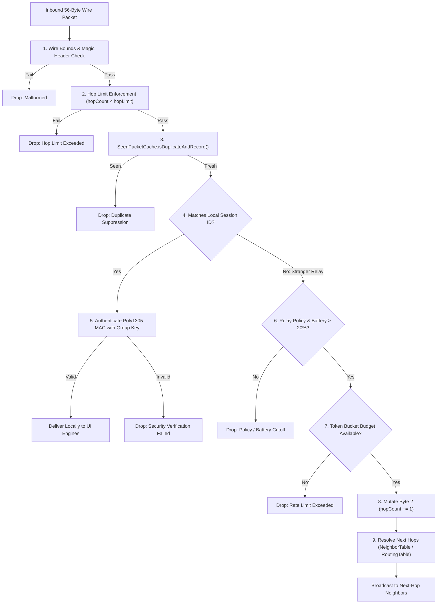

# TeeKum Code Handbook — Volume 04: Mesh Routing Engine

This volume provides an exhaustive, code-block by code-block analysis of TeeKum's Ad-hoc On-Demand Distance Vector (AODV) routing, multi-hop packet forwarding, zero-knowledge blind relaying, duplicate suppression caches, and battery-aware relay policy managers.

---

## 📑 Included Files

1. [`TeeKum Prototype/Core/Mesh/PacketForwarder.swift`](file:///Users/nicho/Developer/TeeKum%20Prototype/TeeKum%20Prototype/Core/Mesh/PacketForwarder.swift) — Main multi-hop packet evaluation, zero-knowledge blind relay, and forwarding pipeline.
2. [`TeeKum Prototype/Core/Mesh/SeenPacketCache.swift`](file:///Users/nicho/Developer/TeeKum%20Prototype/TeeKum%20Prototype/Core/Mesh/SeenPacketCache.swift) — Bounded 1,024-entry LRU duplicate packet suppression cache.
3. [`TeeKum Prototype/Core/Mesh/ForwardingRateLimiter.swift`](file:///Users/nicho/Developer/TeeKum%20Prototype/TeeKum%20Prototype/Core/Mesh/ForwardingRateLimiter.swift) — Dual-lane token bucket rate limiter (2 pkts/s ordinary, 4 pkts/s SOS).
4. [`TeeKum Prototype/Core/Mesh/RoutingTable.swift`](file:///Users/nicho/Developer/TeeKum%20Prototype/TeeKum%20Prototype/Core/Mesh/RoutingTable.swift) — Forward and reverse next-hop routing tables.
5. [`TeeKum Prototype/Core/Mesh/RouteDiscoveryService.swift`](file:///Users/nicho/Developer/TeeKum%20Prototype/TeeKum%20Prototype/Core/Mesh/RouteDiscoveryService.swift) — Reactive AODV route discovery engine (`ROUTE_REQ` / `ROUTE_RESP`).
6. [`TeeKum Prototype/Core/Mesh/NeighborTable.swift`](file:///Users/nicho/Developer/TeeKum%20Prototype/TeeKum%20Prototype/Core/Mesh/NeighborTable.swift) — 1-hop radio neighbor health and packet loss tracker.
7. [`TeeKum Prototype/Core/Mesh/RelayPolicyManager.swift`](file:///Users/nicho/Developer/TeeKum%20Prototype/TeeKum%20Prototype/Core/Mesh/RelayPolicyManager.swift) — Communal mesh participation modes, 20% battery cutoff, and telemetry.
8. [`TeeKum Prototype/Core/Mesh/MeshTimingConfiguration.swift`](file:///Users/nicho/Developer/TeeKum%20Prototype/TeeKum%20Prototype/Core/Mesh/MeshTimingConfiguration.swift) — Mesh intervals, TTLs, and thresholds.
9. [`TeeKum Prototype/Core/Mesh/MeshProtocols.swift`](file:///Users/nicho/Developer/TeeKum%20Prototype/TeeKum%20Prototype/Core/Mesh/MeshProtocols.swift) — Abstract interfaces for mesh dependency injection.

---

# 1. Multi-Hop Forwarding Pipeline: `PacketForwarder.swift`



---

## 1.1 Inbound Evaluation & Header Validation

```swift
    public func evaluateInboundPacket(
        wireData: Data,
        fromPeerId: String
    ) async -> ForwardingDecision {
        totalEvaluatedCount += 1
        
        // 1. Strict Size & Wire Integrity Verification
        guard wireData.count == PacketConstants.wirePacketSize else {
            totalDroppedMalformedCount += 1
            return .dropMalformed
        }
        
        let byte0 = wireData[wireData.startIndex]
        let version = (byte0 >> 4) & 0x0F
        guard version == PacketConstants.protocolVersion else {
            totalDroppedMalformedCount += 1
            return .dropMalformed
        }
        
        guard let packetType = PacketType(rawValue: byte0 & 0x0F) else {
            totalDroppedMalformedCount += 1
            return .dropMalformed
        }
        
        let hopLimit = wireData[wireData.startIndex + 1]
        let hopCount = wireData[wireData.startIndex + 2]
```

### Line-by-Line Breakdown
* `guard wireData.count == PacketConstants.wirePacketSize`: Enforces the 56-byte wire invariant. Any runt packet or oversized buffer is immediately rejected.
* `let version = (byte0 >> 4) & 0x0F`: Reads high 4 bits. If `version != 0x03`, drops to prevent protocol version confusion.
* `let hopCount = wireData[wireData.startIndex + 2]`: Extracts the current hop counter without parsing the ciphertext or allocating memory.

---

## 1.2 Type-Specific Hop Limits & Loop Prevention

```swift
        let effectiveLimit: UInt8
        switch packetType {
        case .sos:
            effectiveLimit = PacketConstants.sosHopLimit           // 15 hops
        case .meetingUpdate:
            effectiveLimit = PacketConstants.meetingPointHopLimit  // 15 hops
        case .chatMessage, .ack:
            effectiveLimit = PacketConstants.chatHopLimit          // 8 hops
        case .uwbTokenExchange:
            effectiveLimit = PacketConstants.uwbHopLimit           // 1 hop
        default:
            effectiveLimit = PacketConstants.defaultHopLimit       // 8 hops
        }
        
        guard hopCount < effectiveLimit else {
            totalDroppedHopLimitCount += 1
            return .dropHopLimitExceeded
        }
```

### Engineering Rationale
* **Emergency Priority**: SOS alerts and Meeting Point broadcasts are allocated up to 15 hops, covering several square kilometers across large festival grounds.
* **Airtime Conservation**: Routine location pings and text messages are capped at 8 hops to prevent radio airtime saturation.
* **Strict 1-Hop Proximity**: Ultra-Wideband (UWB) token exchanges must never be forwarded (`uwbHopLimit = 1`).

---

## 1.3 Zero-Knowledge Blind Relaying & Battery Cutoff

```swift
        // 4. Stranger Packet Relaying: Opt-In & Battery Policy Gate
        let policyState: RelayPolicyState
        if let pm = policyManager {
            policyState = await pm.currentState()
        } else if let provider = policyProvider {
            policyState = provider()
        } else {
            policyState = RelayPolicyState(mode: .communalRelayActive)
        }
        
        let now = clock.now()
        guard policyState.isPermitted(at: now) else {
            totalDroppedPolicyCount += 1
            if policyState.batteryLevel < 0.20 || policyState.isLowPowerModeActive {
                totalDroppedBatteryCount += 1
            }
            return .dropPolicyDisabled
        }
```

### The Zero-Knowledge Contract
* When an iPhone receives a packet for a different group session (`sessionId != localSession.sessionId`), the phone acts as an **opaque relay**.
* The relay node **does not have the decryption key**. It cannot decrypt the 30-byte payload or see coordinates, text, or names.
* **The 20% Battery Hard Cutoff**: If the device battery drops below 20% (`batteryLevel < 0.20`) or the user enables iOS Low Power Mode, the phone immediately ceases stranger packet relaying to protect the owner's emergency battery life.

---

## 1.4 Wire Mutation: Incrementing `hopCount`

```swift
        // 6. Mutable Metadata Mutation (Byte 2: hopCount &+= 1)
        var mutatedData = wireData
        mutatedData[mutatedData.startIndex + 2] = hopCount + 1
```

### Why Wire Integrity Remains Intact
* Notice that **ONLY Byte 2** is modified.
* Because `CleartextEnvelope.authenticatedAssociatedData()` masks Byte 2 to `0x00` during AEAD computation, incrementing `hopCount` does NOT invalidate the sender's 16-byte Poly1305 authentication tag!

---

# 2. `SeenPacketCache.swift`: Duplicate Suppression

```swift
public actor SeenPacketCache {
    public struct CacheEntry: Sendable {
        public let key: PacketKey
        public let arrivalTime: Date
        public var lastAccessed: Date
    }
    
    private let capacity: Int              // Default: 1024
    private let ttl: TimeInterval          // Default: 300s (5 minutes)
    private var entries: [PacketKey: CacheEntry] = [:]
    private var lruOrder: [PacketKey] = []
```

### Memory Footprint & LRU Eviction
* **RAM Budget**: Each `PacketKey` is 7 bytes. At 1,024 entries, the entire deduplication cache occupies less than **8 KB of RAM**.
* **Atomic Deduplication**:
  ```swift
  public func isDuplicateAndRecord(_ key: PacketKey, now: Date? = nil) -> Bool {
      let currentTime = now ?? clock.now()
      if let existing = entries[key] {
          if currentTime.timeIntervalSince(existing.arrivalTime) < ttl {
              touchLRU(key, now: currentTime)
              return true // Drop duplicate
          }
      }
      recordKey(key, now: currentTime)
      return false // Process fresh packet
  }
  ```

---

# 3. `ForwardingRateLimiter.swift`: Token Bucket Traffic Shaping

```swift
public actor ForwardingRateLimiter: ForwardingBudgetManaging {
    // Ordinary traffic token bucket: 2 pkts/sec
    private let ordinaryCapacity: Double = 4.0
    private let ordinaryRefillRate: Double = 2.0
    private var ordinaryTokens: Double = 4.0
    
    // SOS priority token bucket: 4 pkts/sec
    private let sosCapacity: Double = 8.0
    private let sosRefillRate: Double = 4.0
    private var sosTokens: Double = 8.0
```

### Token Bucket Math
* **Refill Formula**:
  $$\text{tokens} = \min(\text{capacity}, \text{tokens} + \Delta t \times \text{refillRate})$$
* **Bursts**: Allows an initial burst of up to 4 ordinary packets (or 8 SOS packets), then throttles sustained forwarding to 2 packets/second. This prevents malicious flooding attacks or mesh broadcast loops from exhausting device radio airtime.

---

# 4. Routing Systems: `RoutingTable.swift` & `RouteDiscoveryService.swift`

## 4.1 Forward & Ephemeral Reverse Routes

```swift
public actor RoutingTable: RoutingTableManaging {
    private var forwardRoutes: [String: RouteEntry] = [:]        // 64 max, 30s-60s TTL
    private var reverseRoutes: [UInt32: ReverseRouteEntry] = [:]  // 128 max, 15s TTL
```

* **Forward Route**: Stores the optimal `nextHopPeerId` towards a destination node based on the freshest sequence number and lowest hop count.
* **Reverse Route**: When a `ROUTE_REQ` hops through intermediary nodes, each node remembers where it came from (`incomingPeerId`) for 15 seconds. When the destination responds with `ROUTE_RESP`, it travels back down the reverse route without flooding the network.

---

## 4.2 Split-Horizon Flooding Defense

```swift
let activeNeighbors = await neighborTable.activeNeighbors()
let eligibleNeighbors = activeNeighbors.filter { $0.id != fromPeerId }
```

* **Split-Horizon Rule**: A packet is NEVER echoed back to the peer from which it was received (`id != fromPeerId`). This eliminates immediate 2-node ping-pong routing loops.

---

Proceed to **[Volume 05: Messaging Pipeline & Codecs](file:///Users/nicho/Developer/TeeKum%20Prototype/docs/handbook/05_messaging_and_codecs.md)**.
